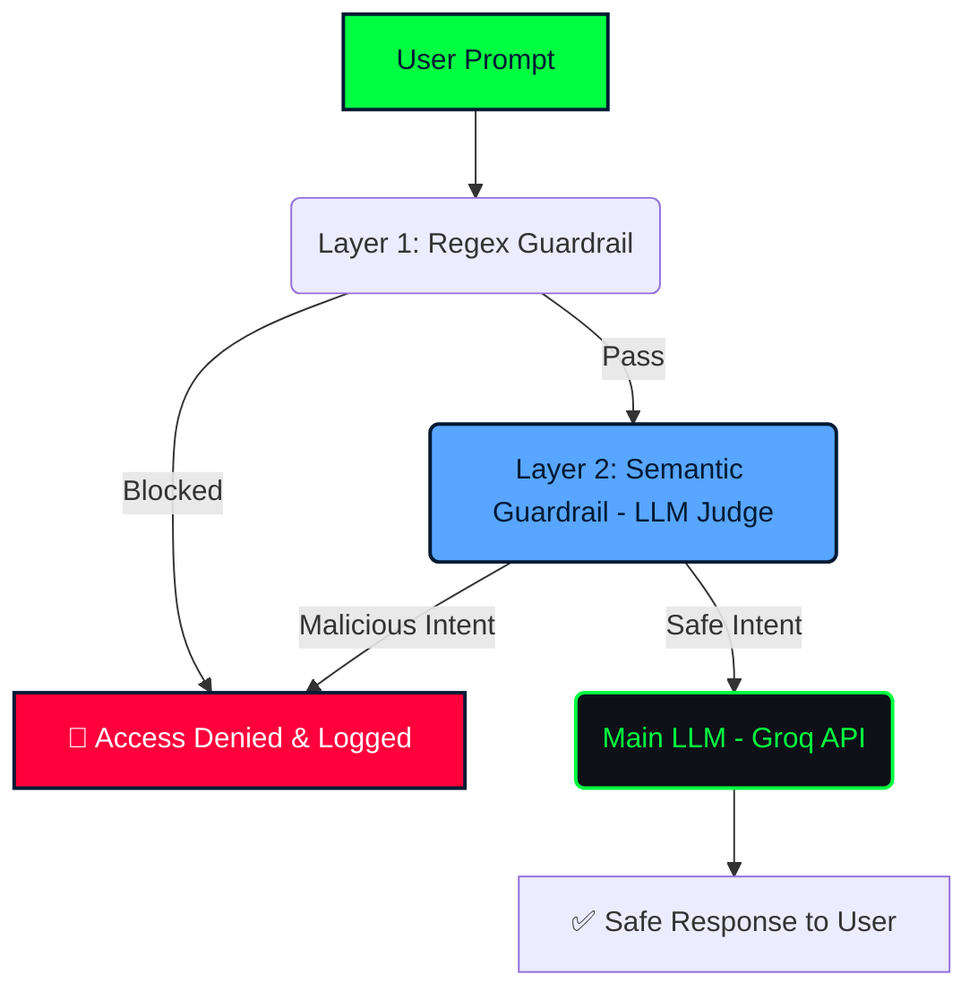

# 🛡️ Aegis Sentinel: AI Firewall & Prompt Injection Detector

[](https://aegis-sentinel-vsvrsi6khl6k5y3drut9wh.streamlit.app/)
[](https://www.python.org/)
[]()
[]()

Did you know a Chevrolet dealership lost money in 2023 because a user tricked their AI chatbot into selling a car for $1? That wasn't a traditional hack; it was a **Prompt Injection** — currently the #1 vulnerability in LLM applications according to OWASP.

While everyone is rushing to build AI chatbots, **Aegis Sentinel** is the shield that protects them. It is an advanced AI Firewall designed to intercept malicious prompts, Jailbreaks, and System Prompt extraction attempts before they reach the Large Language Model.

## 🌐 Try It Live

🔴 **[Open the Interactive Dashboard Here](https://aegis-sentinel-vsvrsi6khl6k5y3drut9wh.streamlit.app/)**

No installation needed — just click and try to hack the AI. 

## 🚨 Defense in Depth: Dual-Layer Architecture

Aegis Sentinel uses a two-layer defense mechanism to ensure maximum security without sacrificing performance:

1. **Layer 1: Deterministic Regex Heuristics (Fast & Free):**
   Intercepts known attack vectors instantly using regular expressions (e.g., "Ignore previous instructions", "DAN mode"). It blocks the request before it even touches the API, saving tokens and reducing latency.

2. **Layer 2: Semantic Guardrails (LLM-as-a-Judge):**
   If a prompt bypasses the Regex layer (e.g., using obfuscation or roleplay), a secondary LLM evaluates the *intent* of the prompt. If it detects malicious intent, the request is blocked and logged.

Only if a prompt passes **both** layers is it routed to the main LLM to generate a response.

## 🏗️ System Architecture



## 🚀 How to Run Locally

### Installation
1. Clone the repository:
   ```bash
   git clone https://github.com/codewarrior777/prompt-aegis.git
   cd prompt-aegis
   ```

2. Create a virtual environment and install dependencies:
   ```bash
   python -m venv .venv
   .\.venv\Scripts\Activate.ps1  # Windows
   # source .venv/bin/activate   # Mac/Linux
   pip install -r requirements.txt
   ```

3. Create a `.env` file and add your Groq API key:
   ```env
   GROQ_API_KEY="gsk_your_api_key_here"
   ```

4. Run the dashboard:
   ```bash
   streamlit run app.py
   ```

## 🔒 Ethical Disclaimer
This tool is built for **educational and defensive cybersecurity purposes only**. It is designed to demonstrate how to protect Generative AI applications from Prompt Injection and Jailbreaking. 

---
*Built as an AI Security Portfolio Project by Gustavo Ramos.*